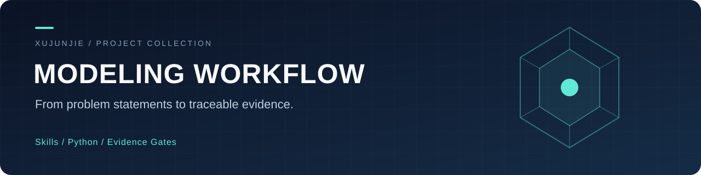
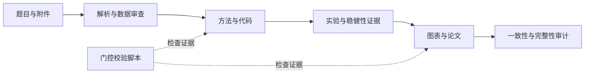

# Math Modeling Workflow
> 面向数学建模竞赛的 Codex 工作流插件，把问题分析、可复现实验与论文证据连接起来。

**Markdown Skills · Python 标准库校验器 · JSON / JSONL · Apache-2.0**

[快速开始](#快速开始) · [工程设计](#工程设计) · [使用教程](使用教程.md) · [English](README_EN.md)

## 项目概览

插件以 `workflow-orchestrator` 为入口，组织题目解析、数据审查、方法选择、代码生成与复核、稳健性检查、图表规划、论文写作和最终审计。

它将工作要求写为 Skills，将进度与关键决定写为机器可读文件，再通过 Python 脚本检查证据是否满足门控条件。仓库提供通用规则、初始化模板与合成示例；实际比赛数据和论文需要在独立项目中准备。

## 核心能力

| 能力 | 工程实现 |
| --- | --- |
| 流程编排 | 按子问题 manifest 和门控状态路由下一项工作 |
| 可复现实验 | 代码计划、运行摘要、基线对比与稳健性检查 |
| 证据追溯 | 决策记录、冻结数值与论文主张来源检查 |
| 双语言路线 | Python 与 MATLAB / 北太天元相关 Skills |
| 论文交付 | 逐题写作、全文装配、格式化与审计指引 |
| 工程验证 | 仓库校验脚本、单元测试与 GitHub Actions |

## 工程设计



实现阅读重点：

- [Skills](plugins/math-modeling-workflow/skills/)：各项工作的输入、输出和执行约束。
- [gate_check.py](plugins/math-modeling-workflow/scripts/gate_check.py)：以文件证据检查阶段门控。
- [check_frozen_numbers.py](plugins/math-modeling-workflow/scripts/check_frozen_numbers.py)：核对论文数字与已冻结证据。
- [初始化模板](plugins/math-modeling-workflow/assets/workspace-template/)：项目目录与初始状态。
- [tests](tests/) 与 [CI](.github/workflows/validate.yml)：验证入口。

## 快速开始

### 注册插件

```powershell
git clone https://github.com/xujunjie-coder/math-modeling-workflow.git
codex plugin marketplace add C:\path\to\math-modeling-workflow
codex plugin add math-modeling-workflow@personal
```

安装后在新的 Codex 任务中使用 Skills。插件声明见 [plugin.json](plugins/math-modeling-workflow/.codex-plugin/plugin.json)，Marketplace 定义见 [marketplace.json](.agents/plugins/marketplace.json)。

### 初始化独立工作区

```powershell
python plugins/math-modeling-workflow/scripts/init_workspace.py C:\path\to\contest-project
```

也可直接复制[工作区模板](plugins/math-modeling-workflow/assets/workspace-template/)，保留隐藏配置与空目录。之后把赛题放入 `problem_statement/`，原始附件放入 `data_raw/`。

在新项目中发出：

```text
请使用 $workflow-orchestrator 检查当前工作区，
严谨度使用 lean，代码语言使用 Python，随机种子使用 2026。
请根据实际证据报告下一项可执行工作。
```

完整上手流程见[使用教程](使用教程.md)与[比赛入门](docs/get-started-competition.zh-CN.md)。

## 工作模式与边界

`lean` 用于探索，`submission` 面向提交材料；升级要求见[检查清单](docs/lean-to-submission-checklist.zh-CN.md)。具体决策与确认机制取决于工作区规则、Skill 版本和门控执行器，应以实际配置和检查结果为准。

仓库同时包含 Auto-Pilot 指令与需要记录决策的门控机制。使用前应核对二者的配置与适用范围；不能把一段自动化提示词视为已经通过全部门控，也不能将生成论文视为已完成学术审核。

## 校验与开发

```powershell
python plugins/math-modeling-workflow/scripts/validate_repo.py .
python -m unittest discover -s tests -v
python plugins/math-modeling-workflow/scripts/gate_check.py C:\path\to\contest-project status
```

在项目工作区检查论文数字：

```powershell
python C:\path\to\math-modeling-workflow\plugins\math-modeling-workflow\scripts\check_frozen_numbers.py paper/master/full_paper.md --source results --source paper/master/claim_map.json
```

这些命令是验证入口，当前 README 不声明本次已执行全量测试。脚本校验也不能代替模型合理性、参考文献真实性和论文内容审核。

## 进一步阅读

- [工作流说明](plugins/math-modeling-workflow/assets/workflow/competition-workflow.zh-CN.md)
- [Skill 路由表](docs/skill-routing.md)
- [目录映射](docs/directory-mapping.zh-CN.md)
- [其他 Agent 的加载方式](docs/agent-agnostic-loading.zh-CN.md)
- [贡献指南](CONTRIBUTING.md) · [更新记录](CHANGELOG.md) · [安全说明](SECURITY.md)

## 许可证与第三方材料

代码、Skills 和原创文档采用 [Apache License 2.0](LICENSE)。比赛题目、数据、论文、模板及其他第三方材料需要单独确认授权；仓库中的 DOCX 文件不应仅凭根目录许可证推定可再分发。

内置校验脚本主要使用 Python 标准库；建模、绘图、文档排版等任务所需的额外依赖应另行核实版本与许可证。
